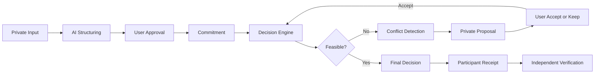

# HUSH - 프라이버시를 보존하는 AI·Web3 집단 협상 시스템 개발

## 1. 프로젝트 개요

HUSH는 여러 사람이 하나의 결정을 내려야 할 때 각자의 민감한 조건을 다른 사람에게 공개하지 않고 합의를 찾도록 돕는 AI·Web3 기반 협상 시스템이다.

> **비밀은 지키고, 반영됐다는 사실은 증명한다.**

| 항목 | 내용 |
| --- | --- |
| 프로젝트 | HUSH |
| 참가 분야 | Web3 기반 사회문제 해결 |
| 개발 기간 | 7주 |
| 팀 구성 | 4인 |
| 핵심 기술 | FastAPI, Gemini, Solidity, Ethereum Sepolia, SQLAlchemy |
| GitHub | [BLOCKCHAIN-AI-HACKATHON-HUSH-](https://github.com/gyuesecurity/BLOCKCHAIN-AI-HACKATHON-HUSH-) |
| Demo | [HUSH Web](https://hush-web-production.up.railway.app) |

HUSH가 해결하려는 문제는 단순한 장소 추천이 아니다. 집단 의사결정에서 개인의 조건을 존중받기 위해 그 조건이 필요한 이유까지 설명해야 하는 구조를 바꾸는 것이 목표였다.

예를 들어 여러 명이 저녁 식사 장소를 정할 때 다음과 같은 조건이 있을 수 있다.

- 경제적인 이유로 식사 비용이 15,000원을 넘으면 안 된다.
- 개인적인 이유로 특정 음식을 먹을 수 없다.
- 휠체어 경사로가 있는 장소가 필요하다.
- 돌봄이나 일정 때문에 21시 이전에 모임이 끝나야 한다.

기존 방식에서는 조건이 충돌하면 결국 "왜 안 되는지"를 설명해야 한다. HUSH는 이유를 밝히지 않아도 조건이 결정에 반영되고, 충돌이 발생했을 때도 필요한 사람에게만 최소한의 조정안을 전달하는 구조를 설계했다.

## 2. 핵심 목표

프로젝트를 설계하면서 다음 세 가지를 핵심 원칙으로 정했다.

### Private Negotiation

각 참여자의 원본 조건과 개인적인 사유는 다른 참여자에게 공개하지 않는다. 공개 화면에는 합의 진행에 필요한 상태만 보여 주고, 구체적인 완화 제안은 해당 조건의 소유자에게만 전달한다.

### User Control

AI는 자연어를 구조화하고 의미를 설명하는 역할만 한다. AI가 사용자의 조건을 임의로 확정하거나 완화하지 않으며, 최종 승인과 변경 결정은 항상 사용자가 수행한다.

### Independent Verification

서버가 "정상적으로 계산했다"고 주장하는 것만으로 결과를 신뢰하지 않는다. 승인된 입력과 결정 결과의 해시를 연결하고, 참여자가 영수증을 이용해 자신의 조건이 최종 입력 집합에 포함됐는지 확인할 수 있도록 했다.

## 3. 시스템 흐름

HUSH의 전체 의사결정 과정은 다음과 같다.



1. 참여자가 자연어로 자신의 조건을 입력한다.
2. AI가 입력을 지원되는 스키마의 조건 후보로 구조화한다.
3. 참여자가 구조화 결과를 확인하고 직접 승인한다.
4. 승인된 조건으로 Commitment를 생성한다.
5. 결정 엔진이 모든 후보와 조건을 평가한다.
6. 해가 없으면 충돌을 분석하고 최소 완화안을 조건 소유자에게만 제안한다.
7. 사용자가 완화를 승인하면 새로운 조건 버전으로 다시 계산한다.
8. 최종 결정과 Participant Receipt를 생성한다.
9. 참여자가 로컬 증거와 온체인 기록을 비교해 결과를 검증한다.

## 4. AI와 결정 엔진을 분리한 이유

처음에는 AI가 사용자의 조건을 이해하고 최종 후보까지 추천하도록 만들 수도 있었다. 하지만 이 방식은 같은 입력에도 결과가 달라질 수 있고, 사용자가 왜 그런 결과가 나왔는지 독립적으로 확인하기 어렵다.

따라서 HUSH에서는 AI와 결정 엔진의 책임을 명확하게 분리했다.

| 구성 요소 | 책임 |
| --- | --- |
| AI | 자연어 입력 구조화와 설명 |
| 사용자 | 조건 확인, 승인, 완화 선택 |
| Decision Engine | 조건 평가, 충돌 탐지, 순위 계산 |
| Backend | 인증, 상태 전이, 저장, 구성 요소 연결 |
| Blockchain | 입력과 결과의 provenance 기록 |

Gemini는 자연어를 `max_price`, `excluded_category`, `accessibility_required`, `latest_end_time` 등의 제한된 스키마로 변환한다. 모델 출력은 곧바로 신뢰하지 않고 타입, 허용 값, 숫자 범위, 시간 형식 검증을 통과해야 한다.

LLM 호출에 실패하거나 API 키가 없으면 규칙 기반 파서로 전환한다. 이때 화면에도 `is_ai=false`와 fallback 상태를 표시해 규칙 파서의 결과를 AI가 생성한 것처럼 표현하지 않았다.

최종 후보는 deterministic Decision Engine이 계산한다. 같은 데이터셋과 같은 승인 입력, 같은 엔진 버전이라면 같은 결과를 얻을 수 있도록 설계했다.

## 5. 데모 시나리오

대표 시나리오는 네 명이 저녁 식사 장소를 정하는 상황이다.

| 참여자 | 비공개 조건 | 조건 유형 |
| --- | --- | --- |
| A | 최대 가격 15,000원 | HARD |
| B | 가능하면 해산물 제외 | SOFT |
| C | 휠체어 경사로 필요 | HARD |
| D | 21시 이전 종료 | HARD |

초기 조건으로 계산하면 모든 HARD 조건을 만족하는 후보가 없어 `NO FEASIBLE SOLUTION`이 된다. 엔진은 후보와 조건을 다시 평가해 A의 가격 상한을 15,000원에서 17,000원으로 조정하면 해가 생긴다는 것을 찾는다.

이 정보는 A의 개인 화면에만 다음과 같은 형태로 전달된다.

```text
가격 상한
15,000원 -> 17,000원

[ACCEPT] [KEEP]
```

공유 화면에는 누가 어떤 조건을 가졌는지, 기존 값이 무엇인지 표시하지 않는다. A가 `ACCEPT`를 선택하면 기존 조건을 덮어쓰는 대신 새 버전을 생성하고 다시 계산한다.

완화 이후 HARD 조건을 만족하는 후보가 두 개 남으면 B의 SOFT 선호를 점수에 반영해 최종 장소를 선택한다. 이를 통해 HARD 조건은 반드시 지키고 SOFT 조건은 가능한 범위에서 선호도에 반영하는 흐름을 구현했다.

## 6. 블록체인을 사용한 이유

HUSH에서 블록체인은 AI의 판단이 옳다는 것을 증명하지 않는다. 대신 어떤 입력 집합과 엔진 버전으로 어떤 결과가 만들어졌는지 운영자와 분리된 공개 기록에 남기는 역할을 한다.

Solidity로 `HushDecisionRegistry`를 구현하고 Ethereum Sepolia에 배포했다.

- 배포 주소: [`0x946ff260a3F67A37c6D0B60bD2E5db905b499cf8`](https://sepolia.etherscan.io/address/0x946ff260a3F67A37c6D0B60bD2E5db905b499cf8)
- 기록 대상: 입력 집합 루트, 후보 데이터셋 해시, 엔진 코드 해시, 최종 결정 해시
- 제외 대상: 원본 조건, 조건 값, salt, 참여자 개인 사유

결정 기록은 다음 순서로 진행된다.

```text
createDecision
  -> commitCondition / supersedeCondition
  -> finalizeInputSet
  -> commitDecision
```

조건이 변경되면 기존 기록을 삭제하지 않고 `supersedeCondition`으로 이전 버전과 새 버전을 연결한다. 최종 Commitment에는 chain ID와 contract address도 포함해 다른 체인이나 컨트랙트의 기록을 그대로 재사용하는 replay를 막았다.

RPC나 트랜잭션 처리에 실패하면 가짜 transaction hash를 만드는 대신 로컬 검증으로 fallback한다. 화면에도 on-chain 검증 여부를 구분해 표시하도록 했다.

## 7. Participant Receipt

각 참여자는 최종 결정 이후 자신의 Participant Receipt를 받을 수 있다. 영수증을 통해 다음 내용을 검증한다.

- 자신이 승인한 조건의 Commitment가 일치하는가
- 자신의 input leaf가 최종 input set root에 포함됐는가
- 후보 데이터셋의 해시가 일치하는가
- 결정 엔진 버전과 코드 해시가 일치하는가
- 최종 결정 해시와 decision commitment가 일치하는가
- 온체인 기록과 로컬 영수증이 동일한가

일반 영수증에는 salt와 같은 preimage material을 포함하지 않는다. 본인 인증을 거친 검증용 export에서만 자신의 검증 재료를 확인할 수 있도록 분리했다.

## 8. 프라이버시와 보안 설계

프로젝트를 구현하며 기능보다 중요하게 본 부분은 데이터가 어느 화면과 API까지 노출될 수 있는지였다.

### 화면 분리

- Participant UI: 본인의 원본 입력, 조건, 완화 제안 확인
- Shared Room UI: 참여 현황과 집계된 안전한 상태만 확인
- Verification UI: 영수증과 공개 기록 검증

공유 화면은 별도의 safe projection API만 사용한다. 단순히 프론트엔드에서 필드를 숨기는 방식이 아니라 서버 응답 단계부터 private field가 포함되지 않도록 했다.

### 저장 데이터 보호

방 상태는 SQLite 또는 PostgreSQL에 저장한다. `HUSH_STATE_KEY`를 설정하면 Fernet으로 저장 blob 전체를 암호화해 원문, salt, 세션 토큰이 평문으로 남지 않게 했다.

### 상태와 권한 검증

- 참여자별 opaque session 발급
- 다른 참여자의 private resource 접근 시 404 처리
- 승인 전후 조건 버전 보존
- 이전 요청 재전송을 고려한 idempotency 처리
- 온체인 실패 시 명시적인 retry 경로 제공
- 보안 헤더와 요청 ID 적용

## 9. 구현 구조

```text
backend/hush/    FastAPI API, 상태 관리, 결정 엔진, 검증
contracts/       Solidity Decision Registry
frontend/        참여자, 공유 방, 검증 화면
fixtures/        버전이 고정된 후보 데이터셋
scripts/         배포, 지갑, 영수증 검증 도구
tests/           API, Engine, Chain, Privacy 테스트
docs/            제품 기획과 아키텍처 문서
```

백엔드는 FastAPI로 구성하고, SQLAlchemy를 이용해 SQLite와 PostgreSQL을 모두 지원했다. Railway에는 Docker 기반으로 배포했으며 Gemini와 Ethereum 연결은 환경변수로 분리했다.

프로젝트 검증 스크립트는 Python 테스트뿐 아니라 JavaScript와 Solidity 검사도 함께 수행한다. 현재 전체 검사 결과는 다음과 같다.

```text
80 passed
HUSH checks passed
```

## 10. 구현하면서 어려웠던 점

### 프라이버시와 검증 가능성의 균형

모든 데이터를 공개하면 검증은 쉬워지지만 프라이버시가 사라진다. 반대로 모든 것을 숨기면 참여자가 자신의 조건이 실제로 반영됐는지 알 수 없다. 원본 값 대신 Commitment와 해시를 사용하고, 본인에게만 검증 재료를 제공하는 방식으로 두 목표 사이의 균형을 맞췄다.

### AI의 역할 제한

AI를 많이 사용할수록 프로젝트가 더 지능적으로 보일 수 있지만, 결과의 재현성과 사용자 통제권은 약해질 수 있다. AI는 구조화와 설명에만 사용하고 실제 조건 평가와 최종 선택은 결정론적 코드가 담당하도록 역할을 줄이는 것이 더 적절하다고 판단했다.

### 온체인 상태와 애플리케이션 상태 동기화

블록체인 트랜잭션은 즉시 확정되지 않으며 nonce, gas estimation, RPC 실패, 응답 유실을 고려해야 한다. 조건 등록, 변경, 최종 결정 단계의 상태를 분리하고 실패 이력을 보존하면서 재시도할 수 있도록 구현했다.

### 최소 정보 공개

공유 API에서 소유자 ID나 조건 값 하나가 실수로 노출되면 시스템의 핵심 목표가 무너진다. 따라서 private surface와 shared surface를 분리하고, 테스트에서 cross-owner 접근과 private field 비노출을 반복해서 검증했다.

## 11. 한계와 개선 방향

현재 구현은 해커톤 범위의 동작 가능한 P0이며 다음과 같은 한계가 있다.

- 온체인 기록은 결과의 provenance와 무결성을 증명하지만 결정 엔진 계산 자체의 정확성을 증명하지는 않는다.
- AI를 사용할 경우 원본 자연어가 외부 LLM provider로 전송된다.
- 단일 Railway worker를 기준으로 설계되어 다중 worker 환경에는 DB lock이나 outbox worker가 추가로 필요하다.
- 복잡한 조건 전체를 다루는 범용 협상 solver가 아니라 지원되는 조건 스키마 안에서 동작한다.
- 완전한 익명성, MPC, 모든 조건에 대한 ZK Proof는 현재 범위에 포함되지 않는다.

향후에는 가격 상한과 같은 수치 조건에 ZK Proof를 적용하고, Merkle 기반 입력 집합과 참여자 서명을 강화할 수 있다. 외부 LLM에 원문을 보내지 않도록 local model을 적용하는 것도 중요한 개선 방향이다.

## 12. 프로젝트 회고

이번 프로젝트를 통해 블록체인을 단순히 데이터를 저장하는 공간으로 사용하는 것과 독립 검증을 위한 신뢰 기반으로 사용하는 것은 다르다는 점을 배웠다. 무엇을 온체인에 기록할지보다 무엇을 절대 기록하면 안 되는지를 먼저 정하는 과정이 중요했다.

또한 AI 기능을 추가하는 것보다 AI가 결정해서는 안 되는 영역을 구분하는 것이 더 어려웠다. 자연어 이해는 AI가 잘할 수 있지만 사용자의 조건 변경과 최종 결정까지 맡기면 통제권과 재현성을 잃게 된다. 그래서 HUSH에서는 AI, 사용자, 결정 엔진, 블록체인의 책임을 분리하는 데 집중했다.

HUSH는 완전한 trustless 협상 시스템은 아니지만, 민감한 사정을 공개하지 않고도 조건을 반영하고 그 결과의 생성 과정을 검증할 수 있는 구조를 실제 서비스 흐름으로 구현했다는 점에서 의미가 있었다.

> **집단의 결정에 내 사정을 반영받기 위해, 왜 그 사정까지 설명해야 하는가?**
